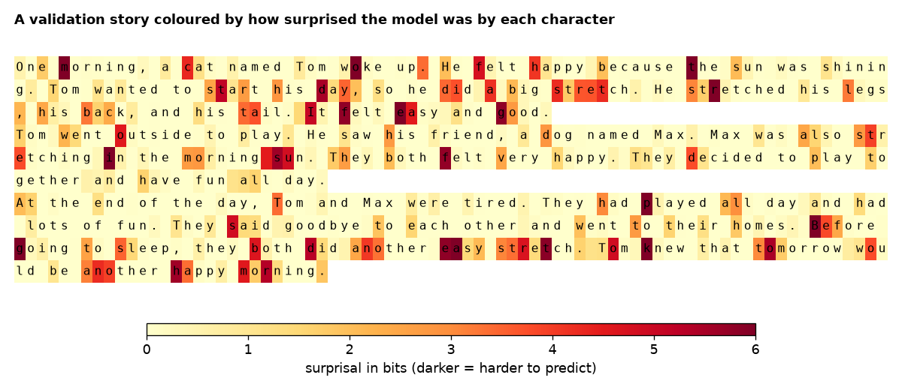
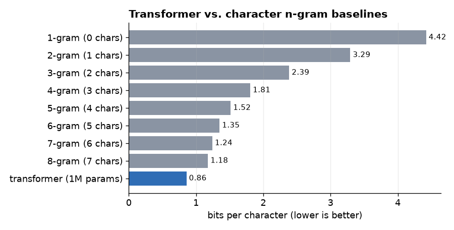
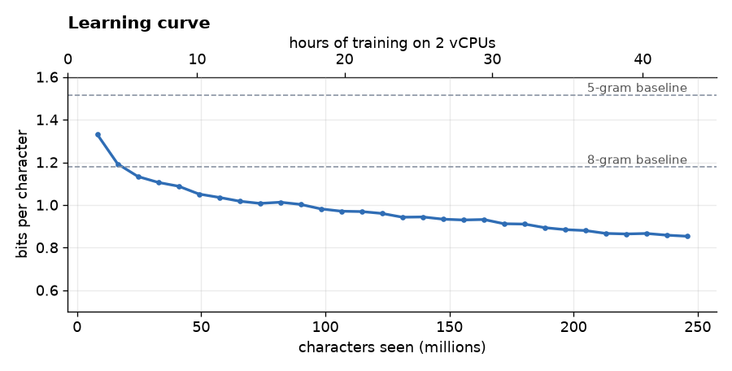
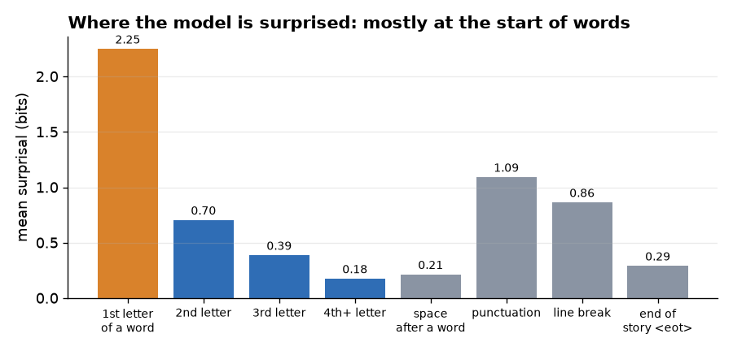
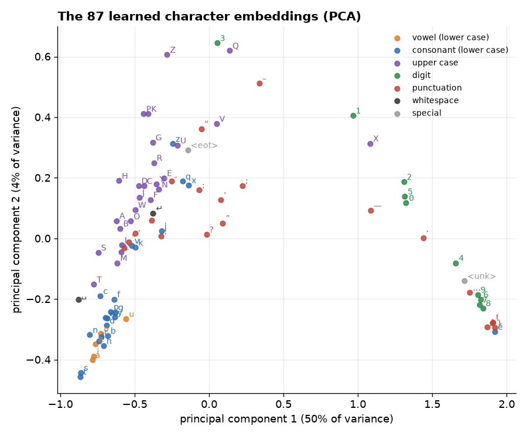
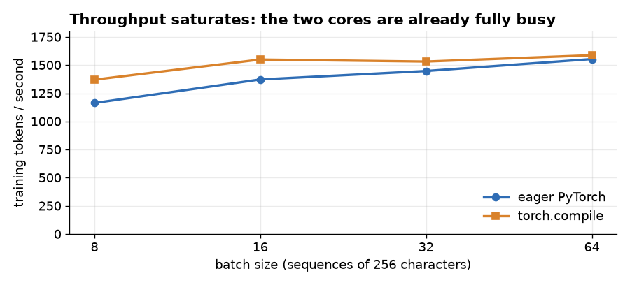

# Can an AI agent build a language model on a CPU from 2013?

A 1-million-parameter, **character-level** language model, built and trained from scratch on a
2-vCPU virtual server with no GPU – with the engineering done by an **AI coding agent** and the
direction by me.

**[Try it in your browser →](https://alexgubgr.github.io/lm_work/demo/)** (the 4 MB model runs on your own
device; nothing is sent anywhere)



| | |
|---|---|
| Model | 1,016,064 parameters, Llama-style transformer, one token per character (87 tokens) |
| Hardware | 2 virtual cores of an Intel Xeon E5-2690 v2 (2013), 8 GB RAM, no GPU |
| Training | 45 hours, 246 million characters of [TinyStories](https://huggingface.co/datasets/roneneldan/TinyStories), ~1.5 petaFLOP |
| Result | **0.857 bits per character** on 22 million held-out characters – **27% better** than the best character n-gram model |

*Technical terms are explained in the [glossary](#glossary) at the end.*

---

## Why I did this

I wanted to find out two things:

1. **How far can agentic AI go?** Can an AI coding agent take a written specification and a weak,
   awkward server, and on its own set up the environment, prepare the data, write the model,
   train it, debug it, evaluate it and explain the results?
2. **How far can you get with character-level tokenisation on a CPU?** Most language models read text
   in chunks of several characters ("tokens"). Reading one letter at a time is the simplest possible
   approach – no tokenizer to train, no unknown words – but it makes every text 3–4 times longer.
   Does that still work on hardware this limited?

### Who did what

| Me (human) | The AI coding agent |
|---|---|
| Wrote the specification: model size (~1M parameters), architecture, character tokens, memory-friendly data handling, CPU efficiency checks, checkpoints, logging | Set up everything on a server **without admin rights**: Python, PyTorch, even a C++ compiler for `torch.compile` |
| Chose the dataset (TinyStories) and the server | Downloaded and converted 2.2 GB of text without ever loading it all into memory |
| Approved the training budget the agent proposed (~2 days) | Wrote the model, training loop, sampling, tests and CI; profiled the CPU and picked settings from measurements |
| Asked for an evaluation, and for this write-up | Ran the training in the background, monitored it, evaluated it against baselines, made the figures and this demo |
| Reviewed the results and commits | Kept a detailed lab notebook: [LOG.md](LOG.md) |

The full session – including the agent's mistakes – is summarised in
[what working with the agent was like](#what-working-with-the-agent-was-like).

---

## Results

### 1. It beats statistical baselines by 27%

A fair yardstick for a character model is an **n-gram model**: a big table that predicts the next
character from the previous *n − 1* characters. I trained n-grams up to 8 characters on 100 million
training characters. The transformer, which can look back up to 255 characters, is 27% better than the
best of them.



### 2. It kept learning for the whole two days



The model passed the 8-gram baseline after about 4–5 hours and was still improving slowly when the
planned budget ran out, so more training would help a little.

### 3. It uses its whole memory – and wants more

How much does it help the model to see more text before guessing the next character? With 1 character
of context it needs 3.3 bits per character; with 8 characters 1.3; with 64 characters 0.86; with 256
characters 0.76.


The curve is **still falling at the end of the window**. The model uses all 256 characters it is given
and would profit from more. This is the main cost of character tokens: 256 characters is only about
50 words – a few sentences – while a typical story here is 700–1,000 characters. That is exactly why the
model forgets who its characters are halfway through a story (see below).

### 4. Spelling is solved, meaning is not

I generated 50 stories and compared them with 500 real ones:

| | generated | real stories |
|---|---|---|
| Real English words | 99.70% | 99.85% |
| Repeated 4-word phrases within a story | 0.84% | 0.83% |
| Story reaches a natural end | 76% | 71% |

On the surface the text is almost indistinguishable from the real thing. But read it:

> Once upon a time, there was a little girl named Lily. Lily loved to play outside in the sand and swim
> in the water. […] Lily was excited and wanted to play on the slide. She took the swing and started to
> play with it. […] **She asked her mom if she could eat the swing**, so she had a red cloth and she
> wanted to play with it too.

One million parameters are enough to learn words, grammar and the rhythm of a children's story – not
enough to keep track of what is happening. Simple statistics like the ones above cannot measure that;
it needs a human or another AI as judge.

### 5. Where the model is surprised: at the start of words

"Surprisal" is how many bits the model needs for a character – how hard it was to guess. The story at the
top of this page is coloured by it. Averaged over 200,000 characters:



- **The first letter of a word makes up 20% of the text but 58% of the total surprise.** Choosing the
  next *word* is the hard part.
- Once a word has started, the model mostly knows how it ends: from the 4th letter on, a character costs
  only 0.18 bits. The space after a word costs 0.21 bits.
- In the coloured story, names such as *Tom* and *Max* are expensive the first time they appear and
  cheap afterwards – the model copies them from earlier in its context.

This is something you can only see this clearly with character tokens: the model effectively learned
its vocabulary letter by letter.

### 6. It discovered the alphabet on its own

Each character is represented internally by a list of 128 numbers (an "embedding") that the model learned.
Squeezing those down to two dimensions (PCA) gives a map of how the model sees the alphabet:



Nobody told the model what a letter, a capital or a digit is, yet:

- the first axis (50% of the variation) separates **frequent** characters (lower-case letters, space) from
  **rare** ones (digits, brackets, *é*, the unknown-character token);
- the second separates **lower case** from **upper case and digits**;
- in the full 128 dimensions, 77% of characters lie closest to the average of their own group
  (vowels, consonants, capitals, digits, punctuation) – even vowels and consonants are partly separated.

### 7. Try it yourself

The [browser demo](https://alexgubgr.github.io/lm_work/demo/) (source in [docs/demo/](docs/demo/)) runs the
trained model in under 200 lines of plain JavaScript – no libraries. A character-level model makes this
easy: the "tokenizer" is a list of 87 characters. It can:

- **write** a story from your opening, colouring each character by how surprising the model found its own
  choice;
- **analyse** your text, colouring every character by surprisal – try a misspelling or an unusual name.

An automated test checks that the JavaScript version gives the same predictions as the PyTorch model.

---

## What I learned about training on an old CPU

| Finding | Why |
|---|---|
| The server delivers about **20 GFLOP/s** (2 cores). | It is a 2013 Ivy Bridge CPU with AVX but not AVX2 or FMA, so PyTorch falls back to its generic code paths. A current laptop is 10–50× faster; a GPU over 1,000×. |
| One training step of 8,192 characters took ~5.3 s (~1,550 characters/s). | The whole run was ~1.5 petaFLOP – a modern GPU would do it in minutes. |
| **`torch.compile` gave no measurable speed-up** (and costs ~80 s per start). | It mainly removes overhead between operations and generates faster kernels for new instruction sets. Here the time is spent inside large matrix multiplications that are already optimised (Intel MKL). |
| The three attention implementations ("flash", "math", default) were equally fast. | Flash attention saves memory traffic, which is not the bottleneck on this CPU. |
| **bfloat16** was not an option. | The CPU has no instructions for it; emulating it would be slower than float32. |
| **Throughput stopped growing at batch size 16** (figure below). | See below. |
| No `multiprocessing` / DataLoader workers. | See below. |



**Why it matters that throughput stopped growing at batch size 16.** On a GPU, bigger batches usually
mean more speed, because thousands of cores are waiting for work. Here, already at batch size 16 the
two cores are fully busy with useful arithmetic, so a bigger batch just takes proportionally longer.
That tells you two things: the code is not wasting time on overhead (otherwise bigger batches would have
helped), and **the only way to train faster is more or faster hardware**. Since speed was the same, I
used batch size 32: it gives smoother gradient estimates at no extra cost.

**Why not multiprocessing?** Training already uses both cores: PyTorch splits every matrix
multiplication across 2 threads (the training process ran at ~180% CPU). Extra processes would compete
for the same two cores and add copying overhead. Loading data is negligible – the training data is
memory-mapped and each batch is just 32 random slices of a file. On a machine with more cores, or several
machines, multiprocessing (PyTorch's distributed data parallel) *would* help; here there is nothing left
to parallelise.

**Generation** is sequential by nature – each character depends on the previous one. What does help is a
**key–value cache**: remembering the model's intermediate results for the text so far, so each new
character costs one small step instead of re-reading the last 256 characters. The browser demo uses one;
`sample.py` does not (it is fast enough for short samples).

---

## What working with the agent was like

**What went well**

- It worked around a hostile environment on its own: no admin rights, no `python3-venv`, no C compiler,
  no Python headers, no `bzip2`. It installed a user-level Python (`uv`), a compiler (`micromamba` +
  conda-forge gcc) and Node.js, all without `sudo`.
- It **measured instead of assuming**. When training was slower than expected it profiled the code, measured
  raw matrix-multiplication speed, found that the hardware – not the code – was the limit, and chose batch
  size, `torch.compile` and the attention backend from benchmarks.
- When asked for CI/CD it added unit tests, an end-to-end smoke test (prepare → train → resume → sample)
  and GitHub Actions workflows, and it kept a lab notebook ([LOG.md](LOG.md)) of every decision.

**Where it needed a human, or made mistakes**

- **It did not evaluate the model until I asked.** It reported validation loss during training but no
  baselines or text-quality checks – the evaluation in this README came from my question "did we
  evaluate it?".
- Its **first vocabulary threshold dropped the digits 4, 6, 7, 8 and 9** as "rare". It noticed when
  inspecting the vocabulary and fixed it.
- A text-replacement command **corrupted an escape sequence** in the data script (`""` became the raw
  character). The agent caught it on the next file check.
- One of its own unit tests was wrong (it assumed a freshly initialised model is maximally uncertain,
  which is not true when the input and target are the same character and the weights are tied). It
  diagnosed the test, not the model, as the problem.
- Its **first estimates were sometimes too optimistic** – for example it expected the CPU to be several
  times faster than it was before measuring.
- **Background jobs and notifications were fragile.** One "tell me when training finishes" watcher never
  reported back, so nothing happened for a night until I checked in.

My take: the agent was excellent at the *engineering* – environment, debugging, measurement, tests –
and needed a human for *direction*: what to evaluate, what matters, when something is "done".

---

## Glossary

| Term | Meaning |
|---|---|
| **Token / tokenisation** | The units a language model reads and writes. Here one token = one character (87 different ones). Most models use *subword* tokens such as "ing" or "play" (often made with BPE – byte-pair encoding), so a text becomes 3–4 times fewer tokens. |
| **Parameter** | One adjustable number inside the model. This model has about one million; large chat models have hundreds of billions. |
| **FLOP** | One floating-point operation – a single multiplication or addition of decimal numbers. |
| **GFLOP/s** | Billions of floating-point operations per second – a measure of how fast a computer does arithmetic. This server: ~20. A modern laptop CPU: several hundred. A modern GPU: tens of thousands. |
| **petaFLOP** | 10¹⁵ (a million billion) floating-point operations – here a measure of total work. Training took ~1.5 petaFLOP, estimated as 6 × parameters × characters seen. |
| **Bits per character** | How many yes/no questions the model needs on average to pin down the next character. Lower is better. Guessing uniformly among 87 characters needs 6.4 bits; knowing only letter frequencies 4.4; this model 0.86. Written English is thought to contain roughly 1 bit per character of real information. |
| **Cross-entropy / loss** | The same quantity in "nats" instead of bits (1 nat = 1.44 bits). What training minimises. |
| **Perplexity** | 2^(bits per character): the model is on average as uncertain as if choosing between this many characters. Here 1.8. |
| **Surprisal** | Bits needed for one particular character: −log₂(probability the model gave it). |
| **n-gram model** | A frequency table: "after these *n − 1* characters, how often did each character follow?" The classic baseline before neural networks. |
| **Context window** | How much previous text the model can see: 256 characters here. |
| **Batch size** | How many text snippets are processed together in one training step (here 32 × 256 characters). |
| **Throughput / saturation** | Characters processed per second. *Saturated* means adding more work per step no longer increases speed, because the hardware is already fully used. |
| **Embedding** | The list of numbers (128 here) the model uses to represent each character. Similar characters end up with similar lists. |
| **PCA** | Principal component analysis: a way to squeeze many dimensions into 2 for plotting while keeping as much of the variation as possible. |
| **Transformer, attention** | The neural-network design behind modern language models; *attention* lets every position look back at all previous positions. |
| **RMSNorm, RoPE, SwiGLU** | Components used in Llama-style models: a normalisation step, a way to encode position by rotating vectors, and the activation function in the feed-forward layers. See [the architecture diagram](docs/architecture.png). |
| **Key–value (KV) cache** | Stored intermediate results for text already processed, so generating the next token does not repeat work. |
| **`torch.compile`** | A PyTorch feature that compiles the model into optimised code. |
| **AVX / AVX2 / FMA, bfloat16** | Families of CPU instructions for fast arithmetic, and a 16-bit number format that halves memory use. The 2013 CPU here has AVX only. |
| **Threads vs processes** | Threads share memory inside one program (PyTorch uses them to split matrix maths across cores); separate processes do not, which suits independent work or several machines. |

---

## Reproduce it

```bash
python -m venv .venv && .venv/bin/pip install torch --index-url https://download.pytorch.org/whl/cpu
.venv/bin/pip install numpy matplotlib

# use the trained model straight away (weights are in docs/demo/)
.venv/bin/python sample.py --ckpt=docs/demo/model.json --prompt="Once upon a time"

# or train from scratch (~2 days on 2 old cores, much faster on a modern machine)
.venv/bin/python prepare.py      # download TinyStoriesV2-GPT4 to data/raw first, see LOG.md
.venv/bin/python train.py        # resumable; see NOTES.md for monitoring, stopping and resuming
.venv/bin/python evaluate.py     # validation loss, n-gram baselines, generated-text metrics
.venv/bin/python analysis/figures.py
```

| File | Purpose |
|---|---|
| [`model.py`](model.py) | The transformer (≈150 lines) |
| [`prepare.py`](prepare.py) | Builds the character vocabulary and converts the text to bytes, in chunks |
| [`train.py`](train.py) | Training loop with checkpoints, resuming and logging |
| [`sample.py`](sample.py) | Generate text |
| [`evaluate.py`](evaluate.py) | Evaluation; report in [docs/eval/EVAL.md](docs/eval/EVAL.md) |
| [`analysis/`](analysis/) | Figures for this README and weight export for the demo |
| [`docs/demo/`](docs/demo/) | Browser demo and exported weights (4 MB) |
| [LOG.md](LOG.md) / [NOTES.md](NOTES.md) | Lab notebook / how to operate the training |

## Licences

- **Code:** MIT – see [LICENSE](LICENSE).
- **Training data:** [TinyStoriesV2-GPT4](https://huggingface.co/datasets/roneneldan/TinyStories) by Eldan & Li,
  licensed [CDLA-Sharing-1.0](https://cdla.dev/sharing-1-0/). The data itself is **not** included in this
  repository. Under CDLA-Sharing-1.0 the trained model weights and the generated texts are *Results*, on
  which the licence places no obligations (§3.5).
- **Model weights** (`docs/demo/model.bin`): released under the same MIT licence as the code.

*Reference:* Ronen Eldan and Yuanzhi Li, “TinyStories: How Small Can Language Models Be and Still Speak
Coherent English?”, 2023. Their 1M-parameter models use subword tokens and are not directly comparable
with the bits-per-character numbers here.
