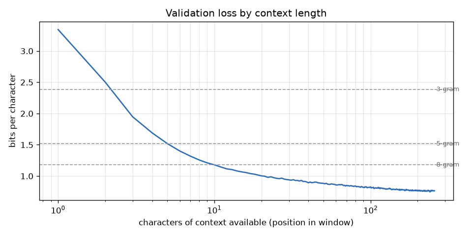

# Evaluation – character-level TinyStories model

Checkpoint `out/best.pt` (iteration 30,000, 245,760,000 training tokens, 1,016,064 parameters).

## 1. Validation loss (full validation set)

| metric | value |
|---|---|
| characters evaluated | 22,161,664 (86,569 windows of 256) |
| cross-entropy | 0.5940 nats/char |
| bits per character | 0.8569 |
| perplexity per character | 1.811 |

Non-overlapping windows: on average a character has 128 characters of context, so this is slightly higher than a sliding-window evaluation would give.

## 2. Baselines: character n-grams

Witten-Bell interpolated n-grams trained on the first 100,000,000 training characters, scored on the first 5,000,000 validation characters.

| model | context | bits/char |
|---|---|---|
| 1-gram | 0 chars | 4.4225 |
| 2-gram | 1 chars | 3.2944 |
| 3-gram | 2 chars | 2.3862 |
| 4-gram | 3 chars | 1.8078 |
| 5-gram | 4 chars | 1.5157 |
| 6-gram | 5 chars | 1.3508 |
| 7-gram | 6 chars | 1.2436 |
| 8-gram | 7 chars | 1.1783 |
| **transformer (1M params)** | up to 255 chars | **0.8579** |

(Transformer row: the same first 4,999,936 validation characters.)

Best n-gram: 8-gram at 1.1783 bits/char. The transformer is 27% lower.

## 3. Loss by position in the context window



| context (chars) | 1 | 2 | 4 | 8 | 16 | 32 | 64 | 128 | 256 |
|---|---|---|---|---|---|---|---|---|---|
| bits/char | 3.343 | 2.503 | 1.690 | 1.257 | 1.055 | 0.942 | 0.859 | 0.791 | 0.764 |

## 4. Generated text

50 stories (10 prompts × 5), temperature 0.8, at most 800 characters, compared with 500 real validation stories cut to the same length. Known words = words that occur ≥3 times in 50M training characters (9,035 words).

| metric | generated | real stories |
|---|---|---|
| known-word rate | 99.70% | 99.85% |
| repeated word 4-grams within a story | 0.84% | 0.83% |
| story finished (<eot> within 800 chars) | 76% | 71% |
| ends with . ! ? or quote | 76% | 73% |
| mean length (chars) | 551 | 692 |

### Examples (first sample of the first three prompts)

```
Once upon a time, there was a little girl named Lily. Lily loved to play outside in the sand and swim in the water. One day, Lily's mom said, "Lily, don't be sad, Lily. Have a fun day today, and sometimes we like to play outside."
Lily was excited and wanted to play on the slide. She took the swing and started to play with it. When she woke up, she wore her coat and started to play. Lily's face would swing on the plant, and then she remembered why. She asked her mom if she could eat the swing, so she had a red cloth and she wanted to play with it too.
Lily took out a show and started to swing on the swing. She saw a big sailor and said, "Wow, that is a nice slide!" Lily said, "Can I touch the slide?" The squirrel looked at Lily and said, "Yes, but be careful. I will make a cake for my own slides."
Lily wa
```

```
One day, a little girl named Lily was playing in her room. She loved to rub her juice in the middle. She wanted to make a picture for all her friends.
While playing, Lily met a big dog. The dog saw Lily and wanted to play too. Lily had an idea. She took out her juice and a small hammer. The dog found a big toy bear to put the juice. Lily was happy.
Lily said, "Thank you, Lily. Let's play together." They played with the juice together. They had fun. The juice. But then, they all went home. Lily was happy.
```

```
Tom and his dog, Spot, loved to play with the ball in the park. One day, Spot saw a big tree with a swing and a swing. Tim was very surprised because he could take the ball from Spot.
Then, something unexpected happened. The ball flew away and jumped on it move with Spot's swing again. Tim was so surprised and asked, "Where did you find the ball?" Spot said, "I had a sweet ball to play with there!" They all played together and had a lot of fun. The ball was a big, shiny ball that Spot could hit the ball. Tim's mom came in and took a cloth and dropped the ball.
But then, something unexpected happened. The ball broke into pieces. Tim and Spot could not find the ball. They could not believe it was hurt. Tim looked at his mom and daddy and said, "Surprise, honey! I am so glad you broke."
Tim smiled and said,
```
